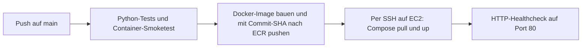

# Tag 14: Deployment nach AWS

## Ausgangsstand

**Weg A:** Dieses Team-Repository (`main`) wird weitergeführt. Es enthält bereits den Tag-13-Stand mit `Dockerfile`, einem Compose-Stack aus `web` und PostgreSQL-`db` sowie `/healthz`. Es war deshalb kein Wechsel auf einen Musterlösungsbranch nötig. Für den Server kommt `docker-compose.prod.yml` hinzu: Das Webimage wird aus ECR gezogen, statt auf EC2 gebaut zu werden. Der interne Webport bleibt 5001; öffentlich ist Port 80 erreichbar. Tests laufen mit `python -m pip install -r requirements-container.txt pytest` und `python -m pytest tests/ -v`.

## Pipeline-Architektur

Der Workflow `.github/workflows/deploy-aws.yml` verknüpft die Jobs mit `needs`. Schlagen Tests oder der Container-Smoketest fehl, wird kein Image veröffentlicht. ECR speichert das Image unter `techstyle:<vollständiger Commit-SHA>`; damit ist der ausgerollte Code eindeutig zuordenbar. Der Deployment-Job kopiert nur Compose und eine zur Laufzeit erzeugte `.env` auf EC2, meldet Docker an ECR an und startet den Stack mit `--wait`. Das PostgreSQL-Volume bleibt bei einem Imagewechsel erhalten. Ein lokaler und ein öffentlicher Healthcheck müssen erfolgreich sein, bevor der Lauf grün wird.

## Einmalige Einrichtung im Learner Lab

1. Lab starten, Region `us-east-1` wählen und in ECR ein **privates** Repository `techstyle` anlegen.
2. Eine Ubuntu-24.04-EC2-Instanz `techstyle-prod` mit Typ `t3.small` und Key Pair `vockey` starten. SSH möglichst auf die benötigten Quelladressen begrenzen; HTTP (Port 80) für den Shop öffnen. Als User Data den Inhalt von `scripts/ec2-user-data.sh` verwenden. Nach dem ersten Start prüfen: `ssh -i labsuser.pem ubuntu@<IP> docker compose version`.
3. In **GitHub → Settings → Secrets and variables → Actions** diese Repository-Secrets setzen:

| Secret | Inhalt |
| --- | --- |
| `AWS_ACCESS_KEY_ID` | Learner-Lab-Zugangsdaten aus AWS Details |
| `AWS_SECRET_ACCESS_KEY` | Learner-Lab-Zugangsdaten aus AWS Details |
| `AWS_SESSION_TOKEN` | Learner-Lab-Session-Token |
| `EC2_HOST` | Öffentliche IPv4-Adresse der Instanz, ohne `http://` |
| `EC2_SSH_PRIVATE_KEY` | Vollständiger Inhalt der heruntergeladenen `labsuser.pem` |
| `EC2_KNOWN_HOSTS` | Verifizierter Hostschlüssel als Zeile `<IP> ssh-ed25519 <öffentlicher Schlüssel>` |
| `POSTGRES_PASSWORD` | Einmalig erzeugter Hexwert mit 64 Zeichen |
| `SECRET_KEY` | Ein anderer Hexwert mit 64 Zeichen für Flask-Sessions |

Die zwei Hexwerte erzeugt man jeweils mit `python -c "import secrets; print(secrets.token_hex(32))"`. `POSTGRES_PASSWORD` nach dem ersten Start **nicht** ändern: Das vorhandene Datenbank-Volume behält das ursprüngliche Passwort. Für `EC2_KNOWN_HOSTS` den öffentlichen Hostschlüssel auf der Instanz mit `sudo cat /etc/ssh/ssh_host_ed25519_key.pub` über eine bereits verifizierte Verbindung oder die EC2-Konsole ablesen. Der Secret-Wert beginnt mit der aktuellen IP, gefolgt vom Inhalt dieser Datei. Den Schlüssel nicht blind aus `ssh-keyscan` übernehmen. Private Schlüssel, AWS-Zugangsdaten und `.env` gehören nie in Git.

## Bedienung und Prüfung

Ein Push auf `main` startet den Workflow **Tag 14 - Deployment auf AWS**. Der erste Lauf benötigt die fertige EC2-Instanz, das ECR-Repository und alle Secrets. Nach einem grünen Lauf `http://<EC2_HOST>/` und `http://<EC2_HOST>/healthz` öffnen. Das Image mit dem SHA-Tag im ECR-Repository prüfen. Eine sichtbare Änderung an `templates/index.html` und ein weiterer Push zeigen, dass das Deployment ohne SSH-Handarbeit funktioniert.

Bei einer neuen Lab-Session die drei `AWS_*`-Secrets erneuern. Falls die Instanz eine neue IP hat, `EC2_HOST` und die IP in `EC2_KNOWN_HOSTS` aktualisieren. Die SSH- und Datenbank-Secrets bleiben nur gültig, solange Instanz, Key Pair und Datenbank-Volume dieselben sind. Für Logs: `ssh -i labsuser.pem ubuntu@<EC2_HOST>` und danach `cd ~/techstyle && docker compose --env-file .env -f docker-compose.prod.yml logs --tail 50 web`. Den Zustand zeigt derselbe Befehl mit `ps` statt `logs --tail 50 web`.

Für ein Rollback den erfolgreichen Workflowlauf eines älteren Commits in GitHub Actions mit **Re-run all jobs** erneut ausführen. Der SHA dieses Laufs wird wieder nach ECR gepusht und auf EC2 ausgerollt. Danach Shop und `/healthz` erneut prüfen. Das ist ein Image-Rollback; Datenbankschema und Daten werden dadurch nicht zurückgesetzt. Für spätere Schemaänderungen braucht es einen separaten Migrations- und Rollback-Plan.

## Nachweise

Diese Werte erst nach einem echten AWS-Lauf ergänzen; lokal sind sie nicht nachweisbar.

- Grüner Workflowlauf: **ausstehend**
- ECR-Image-URI mit Commit-SHA: **ausstehend**
- Öffentliche Shop-URL: **ausstehend**
- Zweites automatisches Deployment und Rollback: **ausstehend**

## Ausblick: ECS

Mit ECS würde GitHub Actions nach dem ECR-Push eine neue Task-Definition mit dem SHA-Image registrieren und den ECS-Service aktualisieren. ECS übernimmt Platzierung, Ersatz ausgefallener Tasks und Healthchecks. SSH, manuelles Compose auf EC2 und die lokale `.env` entfallen. Für PostgreSQL wäre dann ein eigenständiger persistenter Dienst wie RDS sinnvoll; das lokale Compose-Volume eines einzelnen Servers wäre keine geeignete dauerhafte ECS-Datenhaltung.
