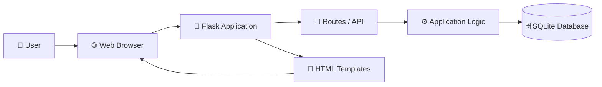
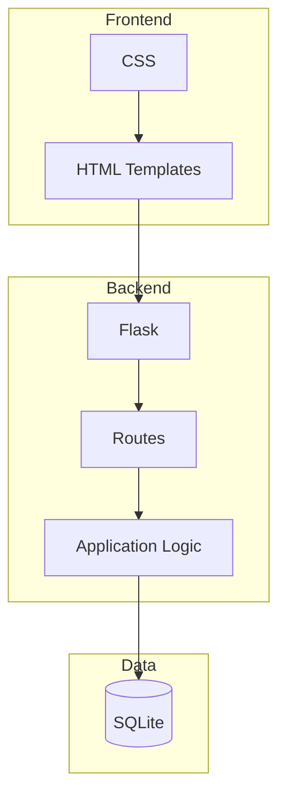
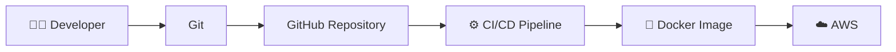
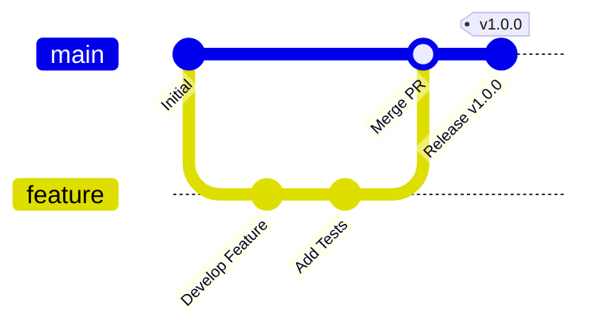

# Architecture

## System Architecture

## Application Components

## Development & Deployment

## Git Workflow

## Technology Stack

| Component | Technology |
|---|---|
| Backend | Python / Flask |
| Database | SQLite |
| Frontend | HTML / CSS / JavaScript |
| Version Control | Git / GitHub |
| Testing | Pytest |
| Container | Docker |
| Deployment | AWS |