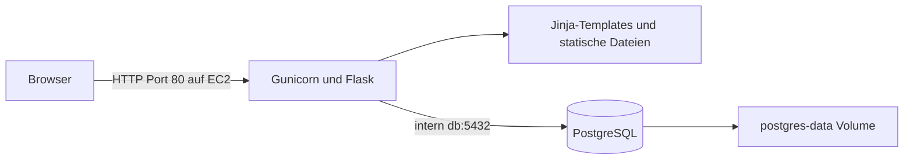
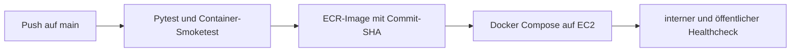

# Architektur

## Aktueller Container- und Cloudstand

Der Shop ist ein Monolith. Ein eigener Datenbankcontainer trennt die Laufzeit von der Datenhaltung, erzeugt aber keine fachlichen Microservices. PostgreSQL veröffentlicht keinen Hostport. Lokal bindet Compose den Webport an `127.0.0.1:5001`; der Produktionsstack veröffentlicht `80:5001`.

`database.py` verwaltet SQLAlchemy-Engine und Schema, `seed_data.py` die Beispieldaten. Der Container initialisiert nur eine leere Datenbank. `/healthz` prüft die Datenbankverbindung und meldet bei deren Ausfall HTTP 503. Ein Containerwechsel lässt das benannte Volume bestehen.

Ohne `DATABASE_URL` verwenden die lokalen Entwicklungsskripte SQLite im temporären Verzeichnis. Diese Variante ist ein Einstieg ohne PostgreSQL und entspricht nicht der Datenhaltung des Cloudstacks.

## Auslieferung

Die Details, Secrets, Betriebsbefehle und belegten Läufe stehen in [DEPLOYMENT.md](../DEPLOYMENT.md). Frühere Blue-Green-/OpenTofu-Beispiele sind unter [archive/](archive/README.md) eingeordnet und betreiben diesen Stack nicht.

## Grenzen

EC2 ist ein einzelner Ausfallpunkt; das Datenbank-Volume liegt auf demselben Server. Der Übungsstack bietet HTTP ohne TLS und hat derzeit ungeschützte Admin-Routen. Ein gesunder `/healthz`-Check bescheinigt Erreichbarkeit und Datenbankzugriff, keine vollständige Sicherheits- oder Hochverfügbarkeitsprüfung.
